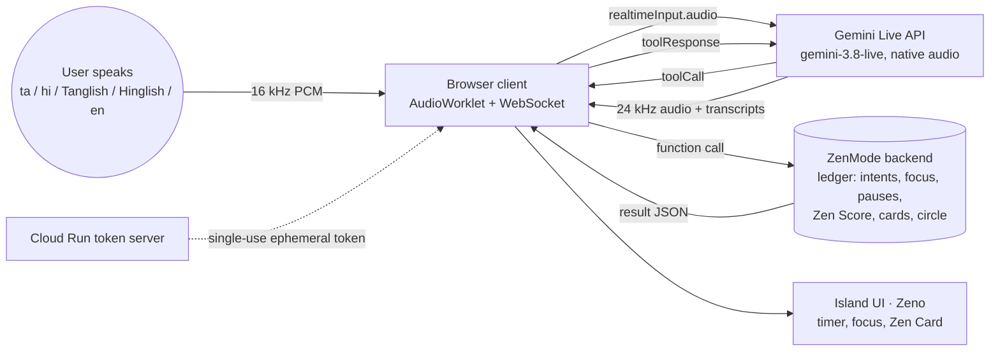

# Zeno Voice · ZenMode OS

**Say why you picked up your phone, in your own language. Zeno does the rest.**

Zeno Voice is a real-time voice agent for [ZenMode OS](https://zenmodeos.com), built on the **Gemini Live API** (native audio-to-audio). Zeno lives in the phone's notch. When you pick up the phone it asks one question, *"What are you here for?"*, understands the answer in Tamil, Hindi, Tanglish, Hinglish or English, and turns it into a real ZenMode action: an intent timer, a focus session across your devices, a pause in front of an app, or an evening Zen Card for your accountability circle.

Built by Team **YC Hackers** (Kamalraaj Senthilkumar, Srinivas Thammana) for **Build with Google Gemini 2026**, track *Open Innovation: Real-World Voice AI with Google Gemini*.

| | |
|---|---|
| Live prototype | https://justkamal07.github.io/zeno-voice/ |
| Demo video | https://justkamal07.github.io/zeno-voice/demo.html |
| Idea deck | [docs/zeno-voice-idea-deck.pdf](docs/zeno-voice-idea-deck.pdf) |
| Prototype deck | [docs/zeno-voice-prototype-deck.pdf](docs/zeno-voice-prototype-deck.pdf) |
| ZenMode OS on Google Play | https://play.google.com/store/apps/details?id=com.zenlauncher.zenmode |
| ZenMode OS source (Android, GPLv3) | https://github.com/ThammanaSrinivas/zenmode |

## Why voice, and why now

- Indians spent about **5 hours a day** on their phones in 2024, 1.1 trillion hours in total ([EY via Bloomberg, Mar 2025](https://www.bloomberg.com/news/articles/2025-03-27/indians-spent-1-1-trillion-hours-on-smartphones-in-2024-ey-says)).
- A typical user picks up the phone **70 to 80 times a day**, and around **half of those pickups have no clear intent**: they happen out of habit ([BCG study, Business Standard, Feb 2024](https://www.business-standard.com/india-news/50-indian-users-unintentionally-reach-out-for-their-smartphones-bcg-study-124021201382_1.html)).
- The moment of pickup is a reflex. Typing an intent is too slow, so people skip it, and every wellbeing app that asks you to type is English-first. Speaking for three seconds, in the language you think in, is fast enough to happen every time.

ZenMode already makes intentional use easier on Android (launcher, Zen Score, 7-second pause, accountability circles; 1.3K+ users, 4.6 on Google Play). Zeno Voice gives it a voice at the exact moment the reflex happens.

## What the prototype does

Open the [live prototype](https://justkamal07.github.io/zeno-voice/) and pick a mode:

- **Live · Gemini.** Paste a Gemini API key (it stays in the tab's memory and goes only to `generativelanguage.googleapis.com`), press **Pick up the phone** and talk. The page streams 16 kHz PCM from your mic to the Gemini Live API over a WebSocket, plays Zeno's 24 kHz native-audio reply, shows both transcripts with their language, executes Zeno's function calls on the ZenMode ledger, handles barge-in interruptions and measures **first-audio latency** from the end of your speech.
- **Demo replay.** The same five moments without a mic or key, with synthesized voices (Kokoro TTS: an Indian female voice for Zeno, an Indian male voice for Kamal). The turns are scripted; every tool call still runs through the real ledger code. This is what the demo video shows.
- **Record live demo.** In live mode, press **Record live demo**, pick this tab, then talk to Zeno. The page records the tab, your mic and Zeno's voice with MediaRecorder and downloads a .webm when you stop.

The five moments:

1. **Pickup.** Zeno asks one question.
2. **Tanglish intent.** *"Arun anuppuna reel-a paakkanum. Insta-la rendu nimisham mattum."* → `set_intent(Instagram, 2 min)` → timer in the island → ended on time, Zen Score up.
3. **Hinglish with an interruption.** *"Mujhe ek ghante ka focus chahiye…"* Zeno starts confirming; *"Nahi nahi, 45 minute. Aur WhatsApp pe pause laga do."* Zeno stops, takes the new number → `start_focus(45)` + `pause_app(WhatsApp, 7s)`.
4. **Status.** *"How's my day looking?"* → `get_zen_status` → the score, said with one fact.
5. **Tamil evening note.** The spoken note becomes a **Zen Card** (`log_reflection`) and is shared with the circle (`share_with_circle`). This is the optional "spoken stories into shareable content" extension.

## How it works



- **Setup:** `models/gemini-3.8-live`, `responseModalities: ["AUDIO"]`, a prebuilt voice, Zeno's system instruction (match the user's language mix, act through tools before confirming, never shame), seven function declarations, automatic activity detection with `START_OF_ACTIVITY_INTERRUPTS`, input and output transcription, sliding-window context compression.
- **Tools** (`src/agent.js`): `get_zen_status`, `set_intent`, `end_session`, `start_focus`, `pause_app`, `log_reflection`, `share_with_circle`. Each one is a ledger operation in `src/ledger.js` and returns plain JSON as the function response.
- **Zen Score rules** follow the ZenMode design system (Albeit): one number from 0 to 10 that can go up; declared intent and on-time sessions earn, running past your own minutes deducts, deductions are shown in ember, never red. A good day is above 6.0; four good days win the week.
- **Privacy:** Screen Time stays on the device. The agent never reads app contents, messages or contacts. The circle only sees the score and cards you choose to share.

### Files

| Path | What |
|---|---|
| `index.html`, `styles.css` | The prototype UI, in the Albeit design system (Clash Display, Geist, Departure Mono) |
| `src/live.js` | Gemini Live client: WebSocket protocol, mic capture, playback, interruptions, tool calls, latency |
| `src/mic-worklet.js` | AudioWorklet: resamples the mic to 16 kHz and packs 40 ms PCM16 chunks |
| `src/agent.js` | Zeno's system instruction, voices, models and function declarations |
| `src/ledger.js` | ZenMode backend, mocked in the browser for the prototype |
| `src/demo.js`, `demo/voice/` | The scripted replay and its synthesized voice clips |
| `src/zeno.js` | Zeno, drawn from the ZenMode mark |
| `server/index.js`, `Dockerfile` | Cloud Run service: serves the app and mints single-use Gemini Live ephemeral tokens so the API key never reaches the browser |
| `docs/` | Idea and prototype decks |

### Run it yourself

```bash
# static, bring your own key
python3 -m http.server 8000   # then open http://localhost:8000/?mode=live

# Cloud Run, key kept server-side
gcloud secrets create gemini-api-key --data-file=- <<< "$GEMINI_API_KEY"
gcloud run deploy zeno-voice --source . --region asia-south1 \
  --set-secrets GEMINI_API_KEY=gemini-api-key:latest --allow-unauthenticated
```

On Cloud Run, leave the key field empty: the page fetches `/token` and connects with `BidiGenerateContentConstrained`.

## Cost per check-in

A check-in is about 12 s of the user's speech, 6 s of Zeno's and a few thousand context tokens. At Gemini Live rates of about $0.005 per input audio minute, $0.018 per output audio minute and $0.75 per million text tokens, one check-in costs roughly **$0.005 (about ₹0.44)**. With four check-ins and one evening note per workday, a ZenMode for Teams seat costs about **$7.9 a year** in Gemini usage, about 16% of a $50 seat. These are estimates, not quotes.

## Status, honestly

- The Live client (setup, mic streaming, playback, transcripts, tool calls, interruptions, latency) follows the documented Gemini Live API protocol and was tested end to end against a local mock of that wire protocol with a fake microphone. Bring your own key to hear Zeno for real.
- The ZenMode backend is mocked in the browser, as the challenge allows. In the product it is the Firebase backend that the Android, iOS and desktop apps already sync through.
- The demo video shows demo replay mode: scripted turns with synthesized voices (Kokoro TTS, generated offline), real tool execution on the ledger code. It is not a recording of a live Gemini session; use **Record live demo** for that.

## License and credits

GPL-3.0, like ZenMode OS. Zeno, the mark and the Albeit design system are ZenMode OS's own. Fonts: Geist and Noto Sans (OFL), Departure Mono (OFL), Clash Display (Indian Type Foundry, ITF Free Font License). Replay voices: Kokoro-82M (Apache-2.0), run offline with sherpa-onnx.
